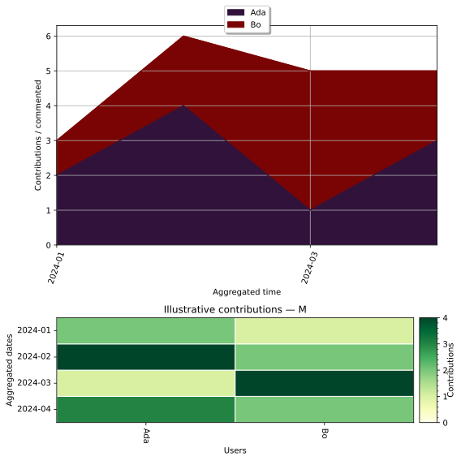
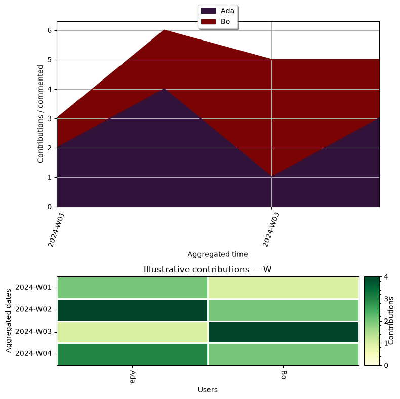
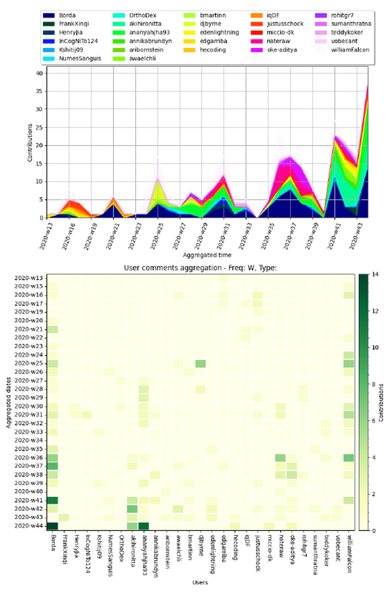

# Repository Stats

[](https://github.com/Borda/pyRepoStats/actions/workflows/ci_testing.yml)
[](https://codecov.io/gh/Borda/pyRepoStats)
[](https://www.codefactor.io/repository/github/borda/pyrepostats)
[](https://results.pre-commit.ci/latest/github/Borda/pyRepoStats/main)

Who actually keeps an open-source project alive? `repostat` answers with numbers Git alone cannot give you: it collects issues, pull requests and their comments from GitHub, caches them locally, and turns them into per-user summaries and contribution timelines.



### Highlighted features

- cumulative **caching**: the first scrape downloads everything, later runs fetch only what changed
- collection of **overall user contributions** to issues/PRs (opened, merged, commented)
- visualization of **aggregated timeline** of past contributions as PDF, PNG or SVG
- **zero-config authentication**: reuses your `gh auth login` session, no token to copy around

## Installation

The package is not on PyPI yet, install it straight from GitHub:

```bash
pip install https://github.com/Borda/pyRepoStats/archive/main.zip
```

or from a clone, which is also the way to develop it:

```bash
git clone https://github.com/Borda/pyRepoStats.git
cd pyRepoStats
pip install -e .
```

## Quick start

```bash
# 1. log in once, repostat picks the session up automatically
gh auth login

# 2. download the repository data (needs internet)
mkdir -p ./stats
repostat scrape Borda/pyRepoStats --output_path ./stats

# 3. analyze the cache (works offline)
repostat analyze Borda/pyRepoStats --output_path ./stats --users_summary+ "merged PRs" --user_comments+ M
```

`python -m repo_stats <command> <repository> [options]` is the same CLI. Always pass `--output_path`, otherwise caches and results land in the installation folder, most likely _site-packages_.

## Authentication

Without a token GitHub allows only 60 requests per hour, which is not enough for any real repository. `repostat` looks for a token in this order and uses the first one it finds:



1. `--auth_token <token>` argument
1. `GH_API_TOKEN` environment variable
1. `GITHUB_TOKEN` or `GH_TOKEN` environment variable, the names used by GitHub Actions and the `gh` CLI
1. the session of the [GitHub CLI](https://cli.github.com/): `repostat` runs `gh auth token` and reads the answer from the pipe
1. anonymous access

The `gh` route is the recommended one. After a single `gh auth login` there is nothing to export or paste. `repostat` never prints the token or writes it to disk; GitHub CLI stores its login in the system credential store when available and can fall back to a plaintext file.

> [!WARNING]
> Prefer the `gh` login or an environment variable over `--auth_token`: a token typed on the command line ends up in your shell history and is visible to other users in the process list.

In GitHub Actions the built-in token is enough for public repositories:

```yaml
- run: |
    mkdir -p ./stats
    repostat scrape ${{ github.repository }} --output_path ./stats
  env:
    GITHUB_TOKEN: ${{ secrets.GITHUB_TOKEN }}
```

## How it works

### Scraping is incremental

The `scrape` command first asks GitHub for the cheap listing of all issues and PRs, then compares the `updated_at` stamp of each item with the cache. Only new or changed items get a detailed request for comments and reviews. The cache is written as `dump-github_<owner>-<repo>.json` in the output folder after fetching and preprocessing. An interrupted run can lose its unsaved progress or leave an incomplete cache if interrupted during the write.



If you hit the API limit midway, the run exits with a message and the progress made so far stays in the cache, so the next `scrape` continues from there.

### Analysis filters out the noise

The `analyze` command reads only the cache. Comments from bots (for example `dependabot[bot]`, `codecov`, `stale`), low-value messages such as "LGTM" or "Thanks", and anything outside the `--date_from` / `--date_to` window are dropped before the numbers are computed.



## Analyze command options

Use `--help` to see every option of each command:

```bash
repostat --help
repostat scrape --help
repostat analyze --help
```

- **User summary table**: pick columns with `--users_summary+`, the first one is used for sorting. Available columns are `opened PRs`, `merged PRs`, `commented PRs`, `opened issues`, `commented issues` and `all opened`:

  ```bash
  repostat analyze Borda/pyRepoStats --output_path ./stats --users_summary+ "merged PRs" --users_summary+ "opened issues"
  ```

  | user                                  | merged PRs | opened issues |
  | :------------------------------------ | ---------: | ------------: |
  | dependabot[bot]                       |         29 |             0 |
  | [Borda](https://github.com/Borda)     |         17 |             5 |
  | pre-commit-ci[bot]                    |         11 |             0 |
  | [Copilot](https://github.com/Copilot) |          4 |             0 |

- **Contribution filter**: `--min_contribution N` hides users below `N` in the printed table (using its first selected column) and in charts (using their timeline totals). CSV exports retain all users:

  ```bash
  repostat analyze Borda/pyRepoStats --output_path ./stats --min_contribution 10 --users_summary+ "merged PRs"
  ```

- **Time frame**: `--date_from` and `--date_to` limit created issues, merged PRs and comments/reviews:

  ```bash
  repostat analyze Borda/pyRepoStats --output_path ./stats --date_from "2023-01-01" --date_to "2023-12-31"
  ```

- **Contribution timeline**: `--user_comments+` takes a time granularity (`D` day, `W` week, `M` month, `Y` year) and optionally an item type (`issue`, `pr`, `all`):

  ```bash
  # weekly aggregation over issues and PRs
  repostat analyze Borda/pyRepoStats --output_path ./stats --user_comments+ W

  # weekly aggregation for issues and PRs separately
  repostat analyze Borda/pyRepoStats --output_path ./stats --user_comments+ W --user_comments+ issue --user_comments+ pr

  # weekly and monthly sampling
  repostat analyze Borda/pyRepoStats --output_path ./stats --user_comments+ W --user_comments+ M
  ```

  Each call draws a double chart: (a) cumulative aggregation over all users and (b) a heatmap with time on the Y-axis and users on the X-axis.

- **Figure format**: `--figure_format png` (or `svg`) changes the saved figure type, the default is `pdf`.

### Example output

An illustrative monthly timeline with sample contribution counts:



A weekly view of the same sample counts as PNG, and an older example from a larger project:





## Output files

Everything lands in `--output_path`:

| File                                                          | Content                               |
| :------------------------------------------------------------ | :------------------------------------ |
| `dump-github_<owner>-<repo>.json`                             | the cache written by `scrape`         |
| `github_<owner>-<repo>_users-summary.csv`                     | per-user table                        |
| `github_<owner>-<repo>_user-comments_freq_<F>_type_<T>.csv`   | timeline table                        |
| `github_<owner>-<repo>_user-comments_freq_<F>_type_<T>.<ext>` | timeline figure (`pdf`, `png`, `svg`) |

## Environment variables

| Variable                   | Effect                                                                        |
| :------------------------- | :---------------------------------------------------------------------------- |
| `GH_API_TOKEN`             | GitHub token, takes priority over the variables below                         |
| `GITHUB_TOKEN`, `GH_TOKEN` | GitHub token, as used by GitHub Actions and `gh`                              |
| `SHOW_FIGURE`              | set `SHOW_FIGURE=0` to skip opening figure windows, e.g. on a server or in CI |

## Development

```bash
python -m venv .venv && source .venv/bin/activate
pip install -e . -r tests/requirements.txt
SHOW_FIGURE=0 pytest tests src
```

Linting and formatting are pinned in `.pre-commit-config.yaml`, run them with `pre-commit run --all-files`.

## Contribution

Any help or suggestions are welcome.

- **Questions and ideas**: use [Discussions](https://github.com/Borda/pyRepoStats/discussions), the Q&A category is the place for usage help.
- **Bugs and feature requests**: open an [issue](https://github.com/Borda/pyRepoStats/issues/new/choose).
