# Authentication

Without a token GitHub allows only 60 requests per hour, which is not enough for any real repository. `repostat` looks for a token in this order and uses the first one it finds:

1. `--auth_token <token>` argument
1. `GH_API_TOKEN` environment variable
1. `GITHUB_TOKEN` or `GH_TOKEN` environment variable, the names used by GitHub Actions and the `gh` CLI
1. the session of the [GitHub CLI](https://cli.github.com/): `repostat` runs `gh auth token` and reads the answer from the pipe
1. anonymous access

The `gh` route is the recommended one. After a single `gh auth login` there is nothing to export or paste. `repostat` never prints the token or writes it to disk; GitHub CLI stores its login in the system credential store when available and can fall back to a plaintext file.

!!! warning

    Prefer the `gh` login or an environment variable over `--auth_token`: a token typed on the command line ends up in your shell history and is visible to other users in the process list.
