# How it works

## Scraping is incremental

The `scrape` command first asks GitHub for the cheap listing of all issues and PRs, then compares the `updated_at` stamp of each item with the cache. Only new or changed items get a detailed request for comments and reviews. The cache is written as `dump-github_<owner>-<repo>.json` in the output folder after fetching and preprocessing. An interrupted run can lose its unsaved progress or leave an incomplete cache if interrupted during the write.

If you hit the API limit midway, the run exits with a message and the progress made so far stays in the cache, so the next `scrape` continues from there.

## Analysis filters out the noise

The `analyze` command reads only the cache. Comments from bots (for example `dependabot[bot]`, `codecov`, `stale`), low-value messages such as "LGTM" or "Thanks", and anything outside the `--date_from` / `--date_to` window are dropped before the numbers are computed.

