# Repository Stats

Who actually keeps an open-source project alive? `repostat` answers with numbers Git alone cannot give you: it collects issues, pull requests and their comments from GitHub, caches them locally, and turns them into per-user summaries and contribution timelines.

## Highlighted features

- cumulative **caching**: the first scrape downloads everything, later runs fetch only what changed
- collection of **overall user contributions** to issues/PRs (opened, merged, commented)
- visualization of **aggregated timeline** of past contributions as PDF, PNG or SVG
- **zero-config authentication**: reuses your `gh auth login` session, no token to copy around

## Where to go next

- [Getting started](getting-started.md): install the package and run your first scrape
- [Authentication](authentication.md): how `repostat` finds a GitHub token
- [How it works](how-it-works.md): incremental scraping and noise filtering
- [Usage](usage.md): every option of the `analyze` command, with example output
- [Reference](reference.md): output files and environment variables
- [Contributing](contributing.md): development setup and where to ask questions
