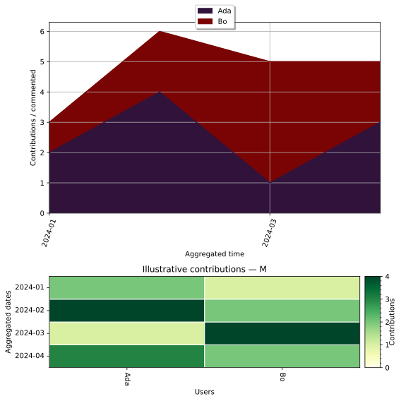
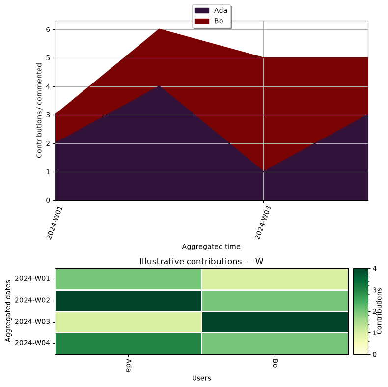
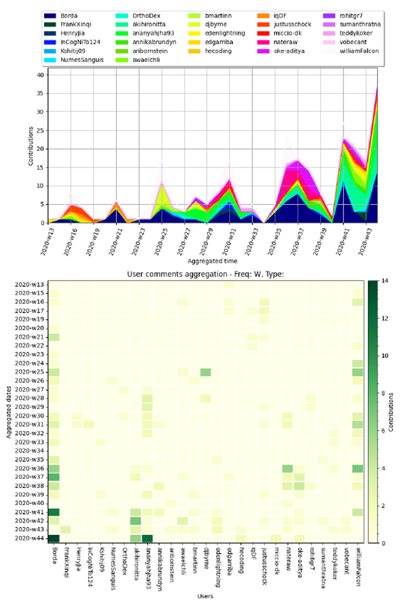

# Usage

Use `--help` to see every option of each command:

```bash
repostat --help
repostat scrape --help
repostat analyze --help
```

## User summary table

Pick columns with `--users_summary+`, the first one is used for sorting. Available columns are `opened PRs`, `merged PRs`, `commented PRs`, `opened issues`, `commented issues` and `all opened`:

```bash
repostat analyze Borda/pyRepoStats --output_path ./stats --users_summary+ "merged PRs" --users_summary+ "opened issues"
```

| user                                  | merged PRs | opened issues |
| :------------------------------------ | ---------: | ------------: |
| dependabot[bot]                       |         29 |             0 |
| [Borda](https://github.com/Borda)     |         17 |             5 |
| pre-commit-ci[bot]                    |         11 |             0 |
| [Copilot](https://github.com/Copilot) |          4 |             0 |

## Contribution filter

`--min_contribution N` hides users below `N` in the printed table (using its first selected column) and in charts (using their timeline totals). CSV exports retain all users:

```bash
repostat analyze Borda/pyRepoStats --output_path ./stats --min_contribution 10 --users_summary+ "merged PRs"
```

## Time frame

`--date_from` and `--date_to` limit created issues, merged PRs and comments/reviews:

```bash
repostat analyze Borda/pyRepoStats --output_path ./stats --date_from "2023-01-01" --date_to "2023-12-31"
```

## Contribution timeline

`--user_comments+` takes a time granularity (`D` day, `W` week, `M` month, `Y` year) and optionally an item type (`issue`, `pr`, `all`):

```bash
# weekly aggregation over issues and PRs
repostat analyze Borda/pyRepoStats --output_path ./stats --user_comments+ W

# weekly aggregation for issues and PRs separately
repostat analyze Borda/pyRepoStats --output_path ./stats --user_comments+ W --user_comments+ issue --user_comments+ pr

# weekly and monthly sampling
repostat analyze Borda/pyRepoStats --output_path ./stats --user_comments+ W --user_comments+ M
```

Each call draws a double chart: (a) cumulative aggregation over all users and (b) a heatmap with time on the Y-axis and users on the X-axis.

## Figure format

`--figure_format png` (or `svg`) changes the saved figure type, the default is `pdf`.

## Example output

An illustrative monthly timeline with sample contribution counts:



A weekly view of the same sample counts as PNG, and an older example from a larger project:




